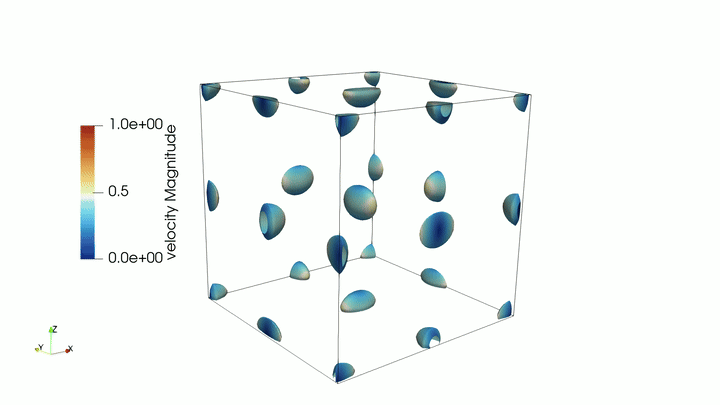
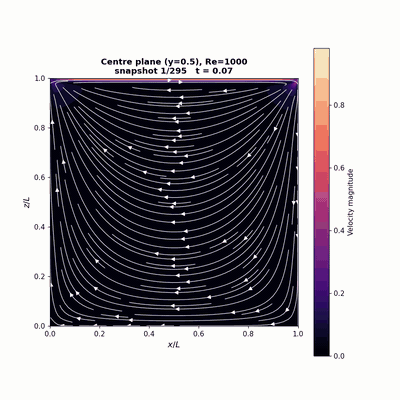
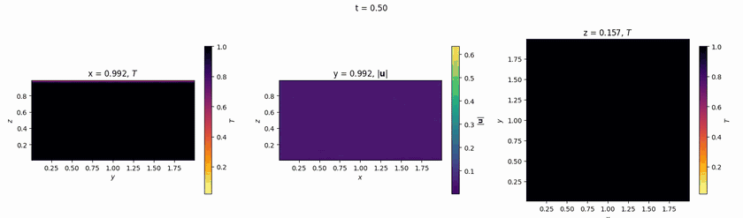

<!-- SPDX-FileCopyrightText: 2026 DOPAMINE contributors -->
<!-- SPDX-License-Identifier: AGPL-3.0-only -->

## DOPAMINE - Discrete Operator-based Parallel Algorithm for Modeling Incompressible Navier–Stokes Equations

**DOPAMINE** is an unstructured, cell-centered Large Eddy Simulation (LES) code for incompressible flows, written in modern Fortran with a PETSc-backed pressure solver and NetCDF/XMF output.

---

## Physics


Solves the incompressible **Boussinesq Navier-Stokes equations** in addition to multiple scalar quantities given by

$$
\partial_t U_i + \partial_j (U_j U_i) = -\frac{1}{\rho}\partial_i p + \partial_j \left[ (\nu + \nu_t) (\partial_j U_i + \partial_i U_j) \right] - \beta (T - T_r) g_i + F_i^{ext} ... ... ... ... (1)
$$

$$
\partial_j U_j = 0 ... ... ... ... (2) 
$$

$$
\partial_t T + \partial_j (U_j T) = \partial_j \left[ \left(\alpha + \frac{\nu_t}{Pr_t}\right) \partial_j T \right] ... ... ... ... (3) 
$$

$$
\partial_t C + \partial_j (U_j C) = \partial_j \left[ D_C \partial_j C \right] ... ... ... ... (4)
$$


where $U_i$ is the velocity vector, $t$ is time, $x_i$ is the space coordinate, $\rho$ is the density of the fluid, $p$ is the pressure, $\nu$ is the kinematic viscosity, $\nu_t$ is the turbulent/eddy viscosity, $\beta$ is the thermal expansion coefficient, $T$ is the temperature field, $T_r$ is the reference temperature field, $g_i$ is the gravitational acceleration vector, $F_i^{ext}$ can represent any additional external forcing, $\alpha$ is the thermal diffusivity constant, $Pr_t$ is the turbulent Prandtl number, $C$ is a generic passive scalar, and $D_C$ its (possibly spatially varying) diffusivity. In


Additional passive scalars can be enabled through `&dopamine_scalars`.
Each scalar uses the same finite-volume transport path with configurable
advection (`VANLEER_TVD`, `KOREN_TVD`, `QUICK`, `CDS`/`CENTRAL`) and
scalar-specific diffusion/closure coefficients.

$F_i^{ext}$ can include constant forcing, rotating-frame Coriolis forcing (`-2 Ω × U`), and harmonic forcing (`A cos(ωt+φ) d`).


### Subgrid-scale models
Selected via `sgs_model` in `&dopamine_numerics`.

**Vreman (2004)** (default) — zero near walls without a damping function:

$$
\nu_t = C_v \cdot \Delta^2 \cdot \sqrt{\frac{B_\beta}{\alpha_{ij}\alpha_{ij}}}
$$

where $\alpha_{ij} = \partial U_j / \partial x_i$, $B_\beta = \beta_{11}\beta_{22} - \beta_{12}^2 + \beta_{11}\beta_{33} - \beta_{13}^2 + \beta_{22}\beta_{33} - \beta_{23}^2$, $\beta_{ij} = \alpha_{ki}\alpha_{kj}$.

**Constant-coefficient Smagorinsky** (`SMAGORINSKY`) — $\nu_t = (C_s \Delta)^2 |S|$ with $C_s$ fixed at 0.1.

**Dynamic Smagorinsky** (`DYNAMIC_SMAG`) — Germano-Lilly dynamic procedure: $C_s^2$ is computed locally every step from a compact test-filtered Germano identity and clipped to $\geq 0$. The mesh is unstructured, so there is no homogeneous direction to plane-average over; a one-ring volume-weighted test filter and one-ring averaging of the Lilly numerator/denominator are used instead, which is noisier than the classic channel-flow formulation.

### Wall model options

**Neutral log-law (default):** Equilibrium log-law wall model (high-Re):

$$
u^+ = \begin{cases}
  (1/\kappa) \ln(y^+) + B & (y^+ > 11.5) \\
  y^+ & (y^+ \leq 11.5)
\end{cases}
$$

Friction velocity $u_\tau$ is found via Newton iteration; wall shear stress $\tau_w = u_\tau^2$ is applied as a Neumann BC on the momentum equations.

#### Atmospheric Modelling (Mainly for Urban Micro-climate simulations)

**Monin-Obukhov Similarity Theory (MOST):** Advanced wall model for thermal coupling and atmospheric flows:
- Coupled momentum and heat flux via Newton iteration
- Dynamic Obukhov length (stability-aware corrections)
- Businger-Dyer functions for stable/neutral/unstable regimes
- Realistic ABL surface layer parameterization
- Enabled via `&dopamine_abl` namelist

### Advection schemes
- **CENTRAL / CDS**: linear central face interpolation; lowest numerical dissipation of the currently implemented options and the preferred choice for WMLES.
- **KEP / SKEW**: momentum uses a midpoint face state with projected face mass flux (Ham-Iaccarino style collocated FV convective form) to reduce numerical dissipation and better preserve resolved kinetic energy on interior faces.
- **QUICK**: geometry-aware quadratic upwind reconstruction in projected streamline coordinates; it reduces to classical QUICK on aligned uniform meshes.
- **KOREN_TVD**: bounded Koren-TVD MUSCL reconstruction using geometry-aware projected slopes, retained as a robust nonlinear option for under-resolved transients.
- **VANLEER_TVD**: bounded van-Leer-TVD MUSCL reconstruction using geometry-aware projected slopes.

Momentum advection is selected via `advection_scheme`, temperature via `temperature_scheme`, and passive scalars via `scalar_tvd_scheme` in `&dopamine_scalars`.

### Viscous scheme
Central differencing (2nd order) with over-relaxed non-orthogonality correction (Jasak 1996).

---

## Quick Start

### 1. Build (Standard)

```sh
mkdir build && cd build
cmake .. -DCMAKE_BUILD_TYPE=Release \
  -DCMAKE_Fortran_COMPILER=mpif90 \
  -DDOPAMINE_ENABLE_PETSC=ON \
  -DDOPAMINE_PETSC_INSTALL_DIR=/path/to/petsc \
  -DDOPAMINE_PETSC_ARCH_DIR=/path/to/petsc-arch
make -j
```

For the full build-options table, offline/HPC (no internet) builds, a
standalone PETSc build recipe, and the GPU (CUDA) and OpenACC (nvfortran)
build paths, see [docs/usage.md](docs/usage.md#build).

### 2. Offline Mesh Decomposition (for large meshes)

For meshes >10M cells, pre-decompose using the `dopamine-decompose` tool:

```sh
mpirun -np 1 ./dopamine-decompose input.input --nranks 128 \
  --output-dir ./mesh_decomposed --max-memory-gb 48
```

Then point the input file at the decomposed mesh (`mesh_file =
'./mesh_decomposed'`, `mesh_type = 'preprocessed'`). See
[docs/usage.md](docs/usage.md#choosing-a-mesh-path) for the decomposer's full
flag list and when to prefer this over direct-read.

### 3. Run Solver

```sh
mpirun -np 16 ./dopamine examples/channel_flow_retau395/channel_retau395.input
```

### 4. Visualize

Open `{prefix}.xmf` in ParaView for mesh and field visualization. See
[docs/usage.md](docs/usage.md#output-and-visualization) for output details
and the ParaView filter sequence for decomposed MPI output.

### 5. Checkpoint and Restart

Checkpoint writing, restart, and repartitioning a checkpoint to a different
rank count are covered in
[docs/usage.md](docs/usage.md#checkpoint-and-restart).

---

## Input File Structure

DOPAMINE uses Fortran namelists. See `reference.input` for a full template. Key blocks:

- `&dopamine_domain` (mesh file/type)
- `&dopamine_numerics` (schemes, time integration, SGS model, tolerances)
- `&dopamine_physics` (viscosity, buoyancy, forcing)
- `&dopamine_bc` (per-patch boundary conditions)
- `&dopamine_initial_condition` (initial field setup)
- `&dopamine_abl` (optional atmospheric boundary layer)
- `&dopamine_output` (output prefix, intervals)
- `&dopamine_checkpoint` (optional checkpoint/restart)
- `&dopamine_stats` (optional runtime statistics cadence)
- `&dopamine_PetscParams` (optional PETSc option overrides)
- `&dopamine_scalars` (optional passive scalars)
- `&dopamine_scalar_sources` (optional sources)
- `&dopamine_sampling_planes`/`lines`/`curves`/`surfaces` (optional sampling)

Example:

```fortran
&dopamine_domain
    mesh_file = 'channel.msh'
    mesh_type = 'gmsh'
/
&dopamine_numerics
    advection_scheme    = 'KEP'
    temperature_scheme  = 'VANLEER_TVD'
    time_integrator     = 'RK3W'
    dt                  = 5.0e-4
    t_end               = 200.0
    cfl_max             = 0.5
    adapt_dt            = .true.
    p_tol               = 1.0e-8
    p_max_iter          = 500
/
```

---

## Output Files

- `{prefix}.nc` — merged unstructured mesh + time-series cell fields (`p`, `U`, `T`, scalars)
- `{prefix}.xmf` — temporal XDMF sidecar for ParaView
- `{prefix}_stats.csv` — runtime statistics (if enabled)
- `{prefix}_sample_{kind}_{name}.nc` — optional sampling outputs

See [docs/usage.md](docs/usage.md#output-and-visualization) for the ParaView
filter sequence for decomposed MPI output.

---

## Supported Mesh Formats

Gmsh v4 (`.msh`) and OpenFOAM `polyMesh`. See
[docs/usage.md](docs/usage.md#supported-mesh-formats) for supported cell
types and file layout.

---

## Example Cases

See `examples/` for ready-to-run input files:

- Channel flow (`channel_flow_retau395/`)
- Lid-driven cavity (`lid_driven_cavity/`)
- Taylor-Green vortex (`taylor_green/`)
- Thermal convection (`thermal_convection/`)

---

## Documentation

The `docs/` folder is published as a [GitHub Pages site](https://akshaypatil1994.github.io/dopamine/)
(Settings → Pages → source `/docs`) and also builds standalone as a single
PDF/HTML manual via `bash docs/build.sh` (see [docs/README.md](docs/README.md)).

- [docs/theory.md](docs/theory.md): Governing equations, discretization, and numerical implementation
- [docs/usage.md](docs/usage.md): Full build/run guide — build options, offline/HPC builds, GPU (CUDA) and OpenACC builds, mesh decomposition, input/output, examples, and troubleshooting
- [docs/development.md](docs/development.md): Code layout, build system, testing, style, contributing
- [reference.input](reference.input): Complete input template


---

## Showcase

<table>
  <tr>
    <td align="center"><br/><sub>Taylor-Green Vortex</sub></td>
    <td align="center"><br/><sub>Lid-Driven Cavity</sub></td>
  </tr>
  <tr>
    <td align="center"><br/><sub>Channel Flow (Re<sub>τ</sub>=395)</sub></td>
    <td align="center"><br/><sub>Rayleigh-Bénard Convection</sub></td>
  </tr>
</table>

---

## Acknowledgments

I started writing this code as a way to learn a bit more about the finite-volume discretisation from scratch. Initially, it began as an exercise in python which quickly turned to Fortran-2008 standard. A lot of other exisiting codes have inspired including but not limited to **CaNS**, **uDALES**, and **OpenFOAM** that shaped the structure and design of **Dopamine**. A large part of the code took inspiration and foundational knowledge provided from the Coastal Ocean Modelling course (Prof. Oliver Fringer [https://web.stanford.edu/~fringer/]) at Stanford during my PhD, and to the classic textbook by Ferziger, Peric, and Street, (4th Edition) which shaped much of the solver's philosophy and implementation. Also I would like to thank my post-doc advisor Clara García-Sánchez for inspiring many of the ideas implemented here and the wonderful support of the 3DGeoinformation research group.

## Contributing

If you find a bug, see a feature that is interesting, please open a pull request or start a discussion. 

## License

AGPL-3.0-only (see `LICENSE`).

