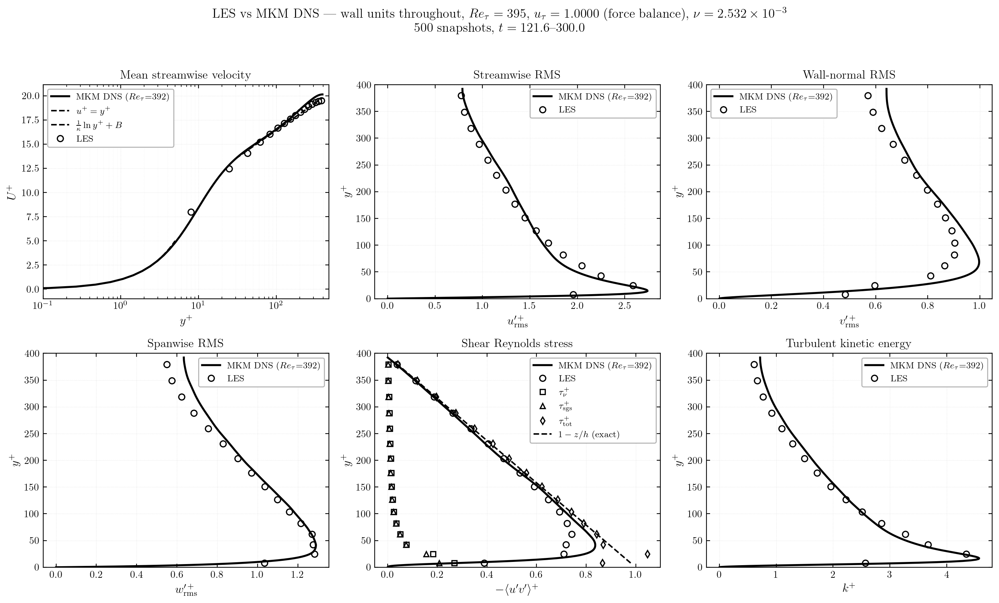
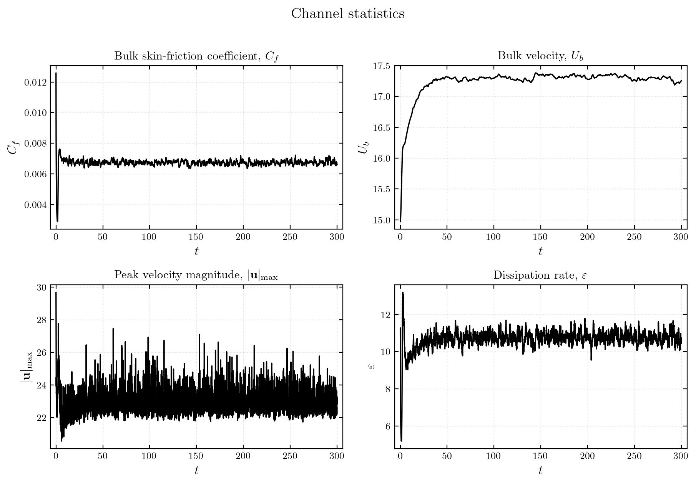

# This tutorial contains the Turbulent Channel Flow using the Vreman sub-grid model

## Step 1: Generating the mesh using the gmsh script

```
gmsh channel.geo -3 -o channel.msh
```

## Step 2: Decomposing the mesh using the Morton (z-order) space filling curve

a. Make a copy of the input file and name it decompose.input (name does not matter and can be different)
b. Single rank runs dont require step 2a
c. Replace the preprocessed field `Block A` with `Block B`

Block A - channel_retau395.input
```
&dopamine_domain
  mesh_file = 'mesh'
  mesh_type = 'preprocessed'
/
```

Block B - decompose.input
```
&dopamine_domain
  mesh_file = 'channel.msh'
  mesh_type = 'gmsh'
/
```

d. Decompose the mesh using the dopamine-decompose utility

```
dopamine-decompose decompose.input --nranks 8 --output-dir mesh
```

## Step 3: Running the solver

```
mpirun -np 8 dopamine channel_retau395.input > dope_run.log 2>&1 &
disown
```

## Step 4: Visualisation

Validation between the DNS and the LES simulation provides confidence in the solvers ability to resolve the dynamics correctly.





Animation generated using a similar script as used for the RayleighBernard case.


