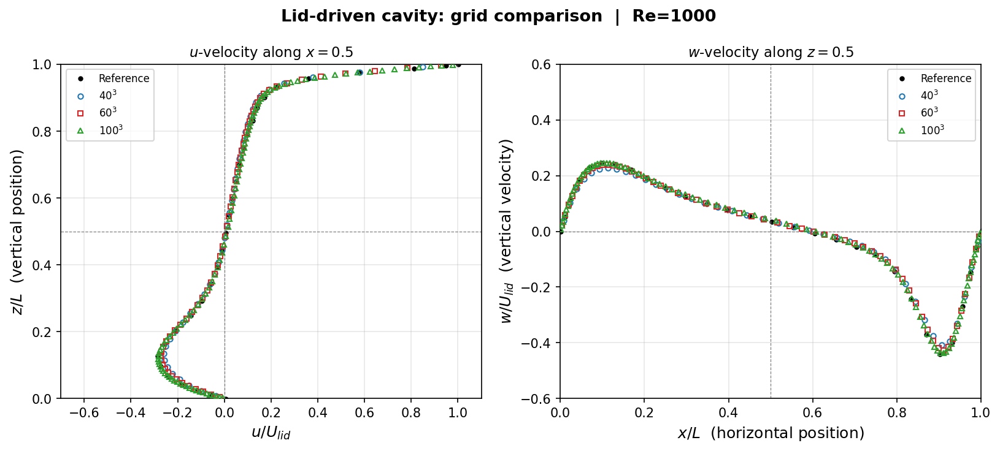
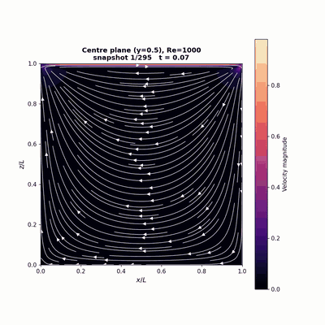

# This tutorial contains the cavity case

## Step 1: Generating the mesh using the gmsh script

```
gmsh cavity.geo -3 -o cavity.msh
```

## Step 2: Decomposing the mesh using the Morton (z-order) space filling curve

a. Make a copy of the input file and name it decompose.input (name does not matter and can be different)
b. Single rank runs dont require step 2a
c. Replace the preprocessed field `Block A` with `Block B`

Block A
```
&dopamine_domain
  mesh_file = 'mesh'
  mesh_type = 'preprocessed'
/
```

Block B
```
&dopamine_domain
  mesh_file = 'cavity.msh'
  mesh_type = 'gmsh'
/
```

d. Decompose the mesh using the dopamine-decompose utility

```
dopamine-decompose decompose.input --nranks 8 --output-dir mesh
```

## Step 3: Running the solver

```
mpirun -np 8 dopamine RB.input > dope_run.log 2>&1 &
disown
```

## Step 4: Visualisation

Grid convergence test suggests that the 3D simulations compare well with the reference data (`compare_grids.py` compares the results).



Based on the write frequency of 3D snapshots, the solver should generate a `cavity.xmf` file which can be imported into paraview to visualise the results. 

Animation created using the helper python script (`animate_cavity.py`)



