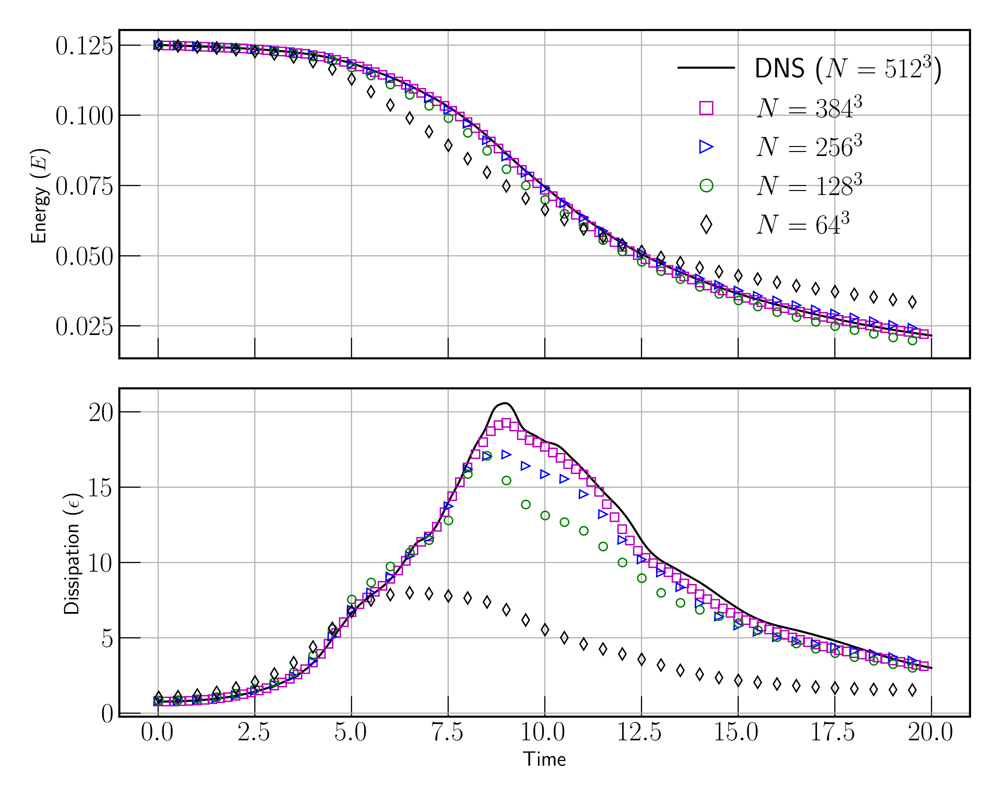
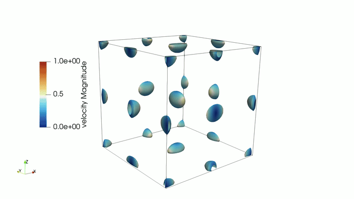

# This tutorial contains the Taylor-Green Vortex case

## Step 1: Generating the mesh using the gmsh script

```
gmsh taylor_green.geo -3 -o taylor_green.msh
```

## Step 2: Decomposing the mesh using the Morton (z-order) space filling curve

a. Make a copy of the input file and name it decompose.input (name does not matter and can be different)
b. Single rank runs dont require step 2a
c. Replace the preprocessed field `Block A` with `Block B`

Block A - taylor_green.input
```
&dopamine_domain
  mesh_file = 'mesh'
  mesh_type = 'preprocessed'
/
```

Block B - decompose.input
```
&dopamine_domain
  mesh_file = 'taylor_green.msh'
  mesh_type = 'gmsh'
/
```

d. Decompose the mesh using the dopamine-decompose utility

```
dopamine-decompose decompose.input --nranks 8 --output-dir mesh
```

## Step 3: Running the solver

```
mpirun -np 8 dopamine taylor_green.input > dope_run.log 2>&1 &
disown
```

## Step 4: Visualisation

The grid sensitivity test shows that the numerics implemented in the solver compare well against reference validation data. It is important to recognise that the dissipation plotted below is gradient-based and not $\epsilon = -dk/dt$ which matches the DNS results exactly.



Animation generated using paraview using `tgv.xmf`. The visualisation compares the iso-surface of the second invariant of the velocity gradient tensor (i.e., Q-criterion) with $Q = -1.0$ which marks the vorticity dominated regions of the flow colored by the velocity magnitude.



